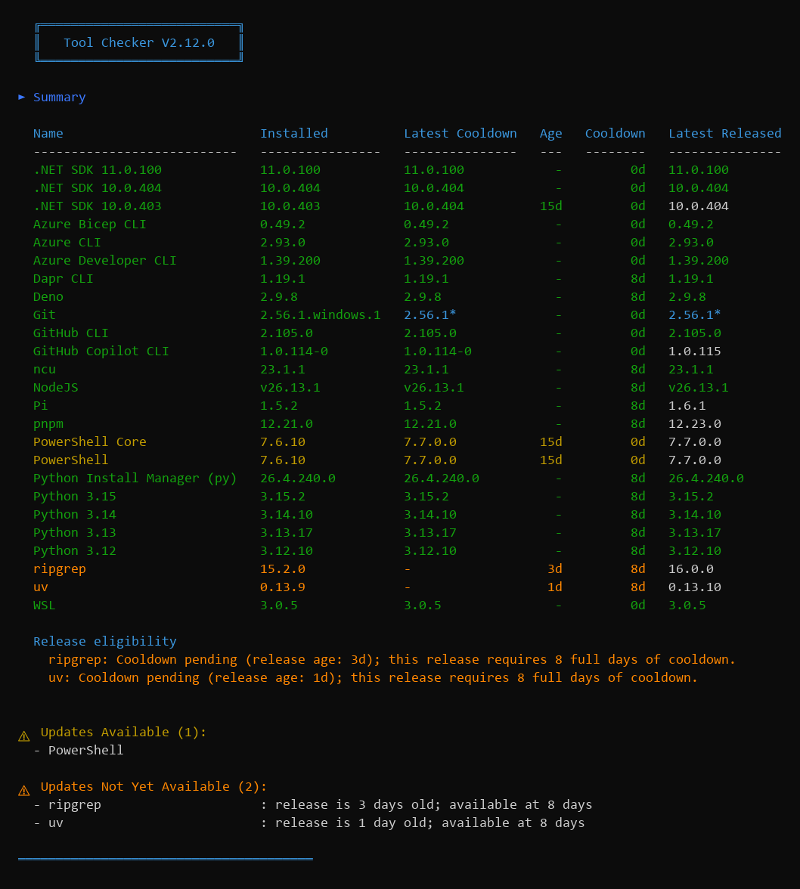
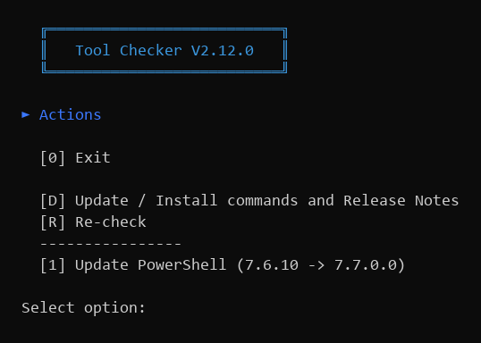

# Tool Checker

**Check your dev tools. Update on your terms.**

A PowerShell script that inventories installed tools, checks for updates in
parallel, and lets you choose what to install or update.

**Windows and Linux | AMD64 and ARM64 | PowerShell 7+**



## Quick start

Requires [PowerShell 7+](https://learn.microsoft.com/powershell/scripting/install/installing-powershell),
internet access, and the package managers used by your selected tools.
No extra PowerShell modules needed.

```powershell
git clone https://github.com/simonkurtz-MSFT/tool-checker.git
Set-Location tool-checker
.\tool-checker.ps1
```

1. **Pick your tools.** First-run setup saves your selection to a local `.env`.
   Press Enter to select all enabled tools.
2. **Review the results.** Compare installed versions, cooldown-eligible updates,
   and the newest releases.
3. **Choose an action, or exit.** Nothing is installed or updated until you approve it.

## Read the results

- **Latest Cooldown** is the checked release eligible under the cooldown policy.
- **Latest Released** is informational, not automatically an update target.
- The default cooldown is **8 days**; newer dated releases wait. No downgrades.
- **Green:** current. **Yellow:** update available or lookup incomplete.
  **Orange:** release not yet eligible. **Red:** missing tool or failure.

## Choose what happens next

| Selection | Action |
| --- | --- |
| `D` | View update/install commands and release notes without executing them. |
| A number | Run that action. Unique numbers can execute without Enter. |
| `,1,3` then Enter | Run multiple actions in the selected order. |
| `A` | Install/update all runnable tools sequentially; offered when at least two actions qualify. |
| `0` or empty Enter | Exit without further changes. |



## Run options

| Option | Use it to... |
| --- | --- |
| `-SkipUpdate` | Inventory installed/missing tools without release lookups. Exit the menu to skip installs. |
| `-Force` | Apply eligible updates in parallel, without prompting; does not install missing tools. |
| `-Unattended` | Run unattended-safe installs/updates once, sequentially. Requires an existing environment file. |
| `-CooldownDays 10` | Override the release cooldown for this run (`0` removes the age delay). |
| `-EnvFile <path>` | Use a different tool-selection and registry-policy file. |
| `-Timeout 120` | Allow up to 120 seconds per check (default: 60). |
| `-Version` | Print the application version and exit. |

Review commands before approving actions or using automatic modes.
**Registry changes and duplicate cleanup always require explicit approval, even with `-Force`.**

## Make it yours

- **Select tools:** edit `TOOL_CHECKER_TOOLS` in your local `.env`.
  See [`.env.example`](.env.example).
- **Set registry policy:** opt in to npm, pnpm, pip, uv, or NuGet settings in `.env`.
  Keep credentials local.
- **Customize checks:** edit the [tool catalog](tool-checker.json).

Included: Node.js, npm packages, pnpm, Deno, uv, Azure CLI and extensions,
Azure Developer CLI, Bicep, Dapr CLI, .NET SDKs, Python and its install manager,
Git, GitHub CLI, GitHub Copilot CLI, Pi, ripgrep, WSL, and PowerShell.
Availability and install commands vary by platform.

## More

- [Usage and configuration reference](docs/reference.md): column details, scheduling, registries, and catalog fields.
- [Contributing](CONTRIBUTING.md) | [Changelog](CHANGELOG.md) | [License](LICENSE)
- [Screenshot capture workflow](docs/capturing-readme-images.md)

*Images: real Tool Checker 2.12.0 output on Windows, November 25, 2026.
Recorded terminal cells rendered to PNG; no installs, updates, or registry repairs performed.*
